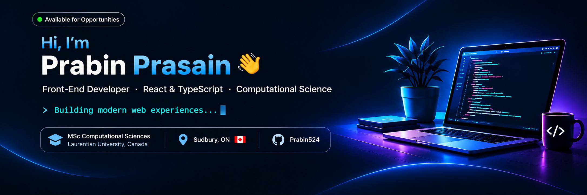

# 

  

  
  
  

---

## 👨‍💻 About Me

I'm a graduate student in **Computational Sciences at Laurentian University, Canada**.

I enjoy building modern, responsive, and user-friendly web applications, exploring AI and intelligent systems, and working on real-world software projects.

🎓 More about me

- 🎓 MSc Computational Sciences
- 💻 Front-End Developer
- ⚛️ React & TypeScript
- 🎨 UI/UX and responsive web design
- 🤖 Interested in AI and intelligent systems
- 🌍 Ontario, Canada

---

## 🛠️ Tech Stack

  

---

## 🚀 Featured Projects

<table>
<tr>
<td width="50%">

### 🌐 Damascus Shawarma

Modern restaurant website featuring responsive design and online ordering links.

**Technologies**

`React` `TypeScript` `Tailwind`

</td>
<td width="50%">

### 🤖 NPM SBOM Risk Agent

Software dependency analysis project focused on identifying and assessing package vulnerabilities.

**Technologies**

`Python` `SBOM` `OSV API`

</td>
</tr>

<tr>
<td width="50%">

### 👥 Employee Management System

Academic project focused on employee management, roles and schedules.

**Technologies**

`React` `API` `UI/UX`

</td>
<td width="50%">

### 💻 Personal Portfolio

Portfolio website showcasing projects, skills and experience.

**Technologies**

`React` `Vite` `Responsive Design`

</td>
</tr>
</table>

  

---

## 📊 GitHub Analytics

  
  

  

---

## 📈 Contribution Activity

  

---

  

  <a href="https://prabinprasain.com.np">Portfolio</a> •
  <a href="mailto:prabinprasainofficial@gmail.com">Email</a> •
  <a href="https://github.com/Prabin524">GitHub</a>

